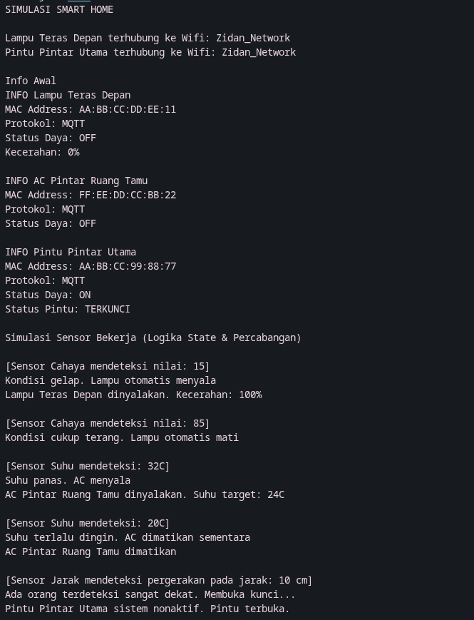
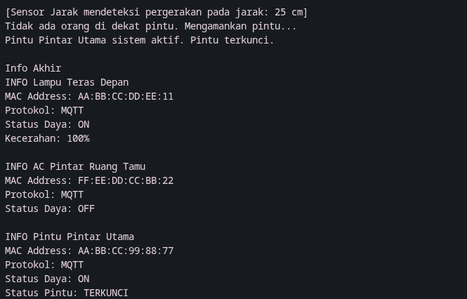

# Responsi Akhir Praktikum PBO - Sistem Smart Home (IoT)

## Identitas Mahasiswa
* **Nama:** Noufal Zidan Ivannov
* **NIM:** H1D025065
* **Tema Sistem:** Internet of Things (IoT) - Digit 5

## Deskripsi Proyek
Proyek ini adalah simulasi Sistem Smart Home berbasis Object-Oriented Programming (OOP) menggunakan bahasa Java. Sistem ini mencakup perangkat cerdas seperti Lampu Pintar, Sistem AC, dan Pintu Pintar yang merespons data sensor lingkungan secara otomatis dan mengelola state secara terenkapsulasi.

## Petunjuk Eksekusi (Compile & Run)
Proyek ini diatur menggunakan pemisahan direktori sumber (`src`) dan direktori kompilasi (`out`).

1. Buka terminal dan arahkan ke dalam direktori *source code* (`src`):
   ```bash
   cd src
   ```
2. Jalankan perintah kompilasi berikut untuk mem-build seluruh kelas dan meletakkan hasilnya di folder `out`:
   ```bash
   javac -d ../out/production/ResponsiPrakPBO *.java
   ```
3. Arahkan terminal ke direktori hasil kompilasi:
   ```bash
   cd ../out/production/ResponsiPrakPBO
   ```
4. Eksekusi program utama:
   ```bash
   java Main
   ```

## Screenshot Luaran Program




## Pemenuhan Persyaratan Teknis
* **State dan Behavior:** Atribut `private` dan method *prosedur/fungsi* diimplementasikan pada kelas `PerangkatIoT`.
* **Immutability:** Terdapat `public static final String PROTOKOL` dan `private final String macAddress`.
* **Enkapsulasi dan Overloading:** Penggunaan *getter/setter*, *keyword* `this`, dan dua variasi konstruktor pembentuk objek.
* **Inheritance:** `LampuPintar`, `SistemAC`, dan `PintuPintar` berelasi *extends* ke `PerangkatIoT`. Kelas `Main` berdiri sendiri.
* **Super Chaining:** Pemanggilan `super(macAddress)` pada konstruktor anak dan `super.tampilkanInfo()`.
* **Method Overriding:** Anotasi `@Override` digunakan pada metode sensor dan kendali daya.
* **Abstract Class:** `PerangkatIoT` berstatus abstrak dengan metode abstrak `prosesDataSensor()`.
* **Logika State Percabangan:** Logika `if/else` pada metode sensor secara otomatis mengubah *state* (menyalakan/mematikan).
* **Polimorfisme Interface:** Instansiasi objek direferensikan lewat antarmuka (`KendaliDaya lampuTeras = new LampuPintar(...)`).
* **Multiple Interface:** Kelas anak mengimplementasikan `KoneksiJaringan` dan `KendaliDaya` sekaligus.